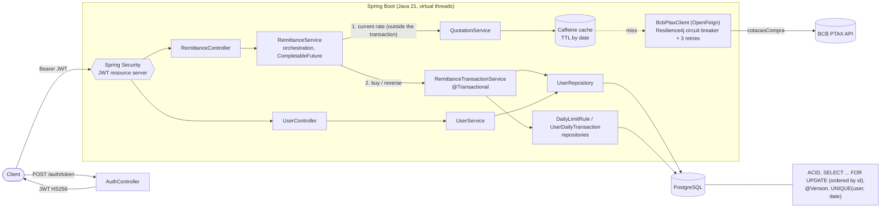

# Inter Remittance – Cross Border

REST API for international remittances (BRL → USD and back), built with Java 21, Spring Boot 4, PostgreSQL and Maven.

## Architecture

| Package | Responsibility |
|---|---|
| `user` | User CRUD (PF/PJ, CPF/CNPJ validation, BRL/USD balances) |
| `quotation` | BCB PTAX client (OpenFeign + circuit breaker + retries), weekend/holiday fallback, Caffeine cache |
| `remittance` | Core business rules: balances, preview, buy, reverse, daily limits. Orchestrates `user` and `quotation` |
| `security` | JWT (HS256) issuing (ADMIN via client credentials, USER via e-mail/password), role and ownership checks |



Key decisions:
- **IDs:** internal `BIGINT` identity primary key; a `public_id` UUID is what the API exposes as `id`.
- **Daily limit:** `daily_limit_rules` (CPF R$ 10,000 / CNPJ R$ 50,000) and `user_daily_transactions` (running total per user per day). Every buy (same-account or external) counts; PF and PJ can send to each other within the limits. Reverse (USD → BRL) is not counted.
- **ACID:** each remittance is one `@Transactional` unit. Rows are locked ordered by id (no deadlocks); the quotation is fetched *before* the transaction so no connection is held while waiting for the BCB.
- **Cache:** quotations are cached by date (Caffeine, TTL `app.cache.quotations.ttl`, default 10 min). Failures are never cached.
- **Stampede protection:** `@Cacheable(sync = true)` makes concurrent misses for the same date share one BCB call.
- **Stale-if-error:** the last successful quotation is kept (`app.cache.quotations.stale-max-age`, default 24h) and served when the BCB fails, instead of answering 503. Each use increments the `quotation.stale.served` metric; with nothing remembered the error is propagated.
- **Cache metrics:** Caffeine runs with `recordStats()`, so Micrometer publishes `cache.gets` (hit/miss), `cache.puts` and `cache.evictions` for the `quotations` cache, plus `quotation.stale.served`; available at `/actuator/metrics` and in Datadog.
- **Concurrency:** virtual threads + `CompletableFuture`; Hikari pool is fixed-size (20) with short timeouts.
- **Errors:** RFC 7807 `ProblemDetail` responses (400, 401, 404, 409, 422, 503).

## Improvements and rationale

Beyond the mandatory requirements, the following decisions were made on purpose. Each one lists the reason.

| Area | Improvement | Reason |
|---|---|---|
| Database | PostgreSQL instead of an in-memory database, with Flyway migrations | Remittances need real row locking (`SELECT ... FOR UPDATE`), `@Version` and constraints that behave like production. An in-memory database (H2) would hide concurrency issues. Flyway makes the schema versioned and reproducible |
| Data model | Internal `BIGINT` PK + public `UUID` exposed by the API | Compact, fast joins and indexes internally, while sequential ids are never leaked to clients (no enumeration) |
| Data model | `daily_limit_rules` and `user_daily_transactions` tables, `UNIQUE(user, date)` | Limits are data, not code: changing a cap needs no deploy. The per-day running total is O(1) to check and doubles as an audit trail |
| Consistency | One `@Transactional` unit per remittance, pessimistic locks ordered by id, `@Version` | Any failure rolls back balances and the daily counter. Ordered locking avoids deadlocks; the version column is a second guard against lost updates |
| Consistency | Quotation fetched **before** opening the transaction | No database connection or lock is held while waiting for a network call |
| Resilience | OpenFeign + Resilience4j circuit breaker + 3 retries | Declarative HTTP client; the breaker stops cascading failures when the BCB is down and the API answers a clean `503` |
| Resilience | Weekend/holiday fallback to the last business day | The BCB publishes no bulletin on non-business days; the last available `cotacaoCompra` is used, with a bounded number of attempts |
| Performance | Caffeine cache by date (TTL 10 min, failures never cached), single-flight on concurrent misses, stale-if-error and cache metrics | The rate changes a few times a day; avoids hammering the BCB and cuts latency under high request volume; a BCB outage degrades to the last known rate and is observable |
| Performance | Virtual threads + `CompletableFuture` | I/O-bound work (BCB calls) does not block platform threads, so throughput scales without a large thread pool |
| Performance | Fixed-size HikariCP pool with short timeouts; G1GC, percentage-based heap, `AlwaysPreTouch` | Predictable memory and connections inside containers, avoiding pauses and latency spikes |
| Security | JWT (HS256) resource server with roles: ADMIN manages users, USER operates only on its own id (`@PreAuthorize`); BCrypt password hashes | Money movements are tied to the authenticated owner, and user administration needs a higher role. Passwords are never stored or returned in clear text and are excluded from `toString` |
| Errors | RFC 7807 `ProblemDetail` with a global `@RestControllerAdvice` | Consistent, machine-readable error contract (400, 401, 404, 409, 422, 503) |
| Design | Layered packages (`controller`, `service`, `repository`, `dto`, `mapper`), records + MapStruct, constructor injection | Low coupling, SOLID, immutable DTOs, easy to mock and test |
| Documentation | OpenAPI/Swagger with descriptions, examples and required flags on every endpoint and field | Self-explanatory API for evaluators and consumers |
| Quality | Unit tests (JUnit 5 + Mockito) and integration tests (Testcontainers + PostgreSQL), JaCoCo coverage | Business rules are verified in isolation and end to end against the real database |
| Operations | Multi-stage `Dockerfile`, `docker-compose`, Kubernetes manifests (probes, resources, secrets), Actuator health | Same artifact from laptop to cluster; the app is observable and restarts safely |

### Why PostgreSQL instead of an in-memory database

Although H2 is commonly used for quick prototyping, **PostgreSQL** running on Docker/Kubernetes was chosen as a production-grade architectural decision:

- **Concurrency correctness:** strict ACID isolation and real row-level locking (`SELECT ... FOR UPDATE`), combined with optimistic versioning (`@Version`), prevent race conditions in balance and daily-limit control. An in-memory database would mask exactly these issues, because its locking and isolation semantics differ from production.
- **Data integrity:** constraints (`UNIQUE` on e-mail, document and `(user, date)`), `NUMERIC` precision for monetary values and versioned Flyway migrations keep the model consistent and reproducible across environments.
- **Scalability:** a standalone server decouples state from the application, so the API scales horizontally behind several replicas sharing one source of truth, with a bounded HikariCP pool sized against `max_connections`.
- **Security and auditability:** durable persistence, role-based access and a queryable audit trail (`user_daily_transactions`) that survive restarts, which a volatile database cannot offer.
- **Observability:** connection-pool metrics (HikariCP via Micrometer), health probes and query-level diagnostics integrate with Datadog, aligning the solution with modern cloud-native standards.

The cost is one extra container, which `docker compose` and Testcontainers make transparent for evaluators.

## Build and run

Requirements: JDK 21 and Docker (PostgreSQL runs in a container; Maven is provided by the wrapper).

```bash
# Compile and package (runs the unit tests; add -DskipTests to skip them)
./mvnw clean package

# PostgreSQL only, then the app from Maven
docker compose up -d postgres
./mvnw spring-boot:run

# Everything in containers (app + PostgreSQL)
docker compose --profile app up --build -d
```

- Swagger UI: http://localhost:8080/swagger-ui/index.html
- Health: http://localhost:8080/actuator/health

**PostgreSQL without Compose.** The official image refuses to start without a superuser password ("Database is uninitialized and superuser password is not specified"). Prefer `docker compose up -d postgres` (defaults are already set in `docker-compose.yml`); if you run the container by hand, pass the variables the application expects:

```bash
docker run -d --name remittance-postgres -p 5432:5432 \
  -e POSTGRES_DB=remittance -e POSTGRES_USER=remittance -e POSTGRES_PASSWORD=remittance \
  postgres:17-alpine
```

### Authentication and authorization

Two kinds of Bearer (JWT, HS256) tokens are issued:

| Token | How to get it | Role | What it can do |
|---|---|---|---|
| ADMIN | `POST /auth/token` with the API client credentials (`remittance-client` / `remittance-secret` by default) | `ADMIN` | List users; read, update and delete any user. **Cannot** operate remittances |
| USER | `POST /auth/login` with the user's e-mail and password | `USER` | Read, update and delete **only their own** profile; balance, preview, buy and reverse **only for their own** `userId` (the token subject must match the id in the request) |

`/users/**` and `/remittances/**` require a token (`401` without it, `403` with the wrong role or another user's id), except `POST /users` (public sign-up, so a person can open an account without being an admin). `/auth/**`, `/quotations` and the Swagger/health endpoints are public. In Swagger UI click **Authorize** and paste the token (without the `Bearer ` prefix). Override the dev defaults with `JWT_SECRET` (>= 32 bytes), `JWT_TTL`, `AUTH_CLIENT_ID`, `AUTH_CLIENT_SECRET`.

## Step-by-step test guide

From user creation to purchase. Use Swagger UI or `curl` (Bash with `jq`; on Windows use Git Bash/WSL).

```bash
# 0. Start the stack
docker compose --profile app up --build -d

# 1. Create the sender (PF, R$ 1,500) and the recipient (PJ). Public sign-up: no token. Valid CPF/CNPJ, unique e-mail and document
# The response is 201 with an empty body; only the new public id is returned, in the Location header
SENDER_ID=$(curl -si -X POST localhost:8080/users -H "Content-Type: application/json" \
  -d '{"name":"Maria Silva","email":"maria@mail.com","document":"529.982.247-25","password":"S3nh@Forte2026","balanceBrl":1500.00}' | grep -i ^location | tr -d '\r' | sed 's#.*/##')
RECIPIENT_ID=$(curl -si -X POST localhost:8080/users -H "Content-Type: application/json" \
  -d '{"name":"Empresa LTDA","email":"empresa@mail.com","document":"11.222.333/0001-81","password":"S3nh@Forte2026"}' | grep -i ^location | tr -d '\r' | sed 's#.*/##')

# 2. Log in as the sender: this USER token only works for the sender's own id
USER=$(curl -s -X POST localhost:8080/auth/login -H "Content-Type: application/json" \
  -d '{"email":"maria@mail.com","password":"S3nh@Forte2026"}' | jq -r .accessToken)

# 3. Quotation (public). Date format is 'MM-dd-yyyy' with single quotes; weekends return the last business day
curl -s -g "localhost:8080/quotations?date='10-01-2026'"

# 4. Balance and preview (BRL cost of USD 100)
curl -s -H "Authorization: Bearer $USER" localhost:8080/remittances/users/$SENDER_ID/balance
curl -s -H "Authorization: Bearer $USER" "localhost:8080/remittances/users/$SENDER_ID/preview?usdAmount=100.00"

# 5. Buy USD for another user (external transfer: recipientDocument is required)
curl -s -X POST localhost:8080/remittances/buy -H "Authorization: Bearer $USER" -H "Content-Type: application/json" \
  -d '{"userId":"'$SENDER_ID'","amountBrl":500.00,"isSameAccount":false,"recipientDocument":"11222333000181"}'

# 6. Buy USD into the sender's own USD wallet (no recipient)
curl -s -X POST localhost:8080/remittances/buy -H "Authorization: Bearer $USER" -H "Content-Type: application/json" \
  -d '{"userId":"'$SENDER_ID'","amountBrl":100.00,"isSameAccount":true}'

# 7. Reverse USD back to BRL: log in as the recipient first, since it is the one holding USD (optionally add "recipientDocument" to credit the BRL to another registered user)
RECIPIENT=$(curl -s -X POST localhost:8080/auth/login -H "Content-Type: application/json" \
  -d '{"email":"empresa@mail.com","password":"S3nh@Forte2026"}' | jq -r .accessToken)
curl -s -X POST localhost:8080/remittances/reverse -H "Authorization: Bearer $RECIPIENT" -H "Content-Type: application/json" \
  -d '{"userId":"'$RECIPIENT_ID'","amountUsd":10.00}'
```

Expected error scenarios (RFC 7807 bodies):

| Scenario | How to trigger | Result |
|---|---|---|
| No / invalid token | Omit the `Authorization` header on `/users` or `/remittances` | `401` |
| Wrong role | List users with a USER token; buy with the ADMIN token | `403` |
| Another user's data | Use Maria's token with `SENDER_ID` replaced by `RECIPIENT_ID` | `403` |
| Wrong login | Wrong password or unknown e-mail on `/auth/login` | `401` |
| Invalid or duplicated CPF/CNPJ or e-mail | Repeat step 1, or use `111.111.111-11` | `400` / `409` |
| Weak password | `"password":"123"` in step 1 | `400` |
| Insufficient balance | `amountBrl` above the sender's BRL balance | `422`, balances unchanged |
| Daily limit exceeded | Buys totalling more than R$ 10,000 (PF) or R$ 50,000 (PJ) in one day | `422`, nothing is debited |
| Minimum amount | `amountBrl` below `1.00` | `400` |
| Invalid date | `/quotations?date=2026-10-01` | `400` |
| BCB unavailable | Stop network access to the BCB | `503`, circuit breaker opens |

After each remittance, call the balance endpoint again: BRL decreases, USD increases, and a failed request leaves both untouched (ACID rollback).

## Tests

### Prerequisites

| Item | Needed for | How to check |
|---|---|---|
| JDK 21 | everything | `java -version` (must print 21) |
| Docker running | integration tests (Testcontainers starts PostgreSQL) | `docker info` (must not fail) |
| Internet | not needed: the BCB client is mocked in tests | n/a |

### Step by step

```bash
# 1. Unit tests only (fast, no Docker)
./mvnw clean test

# 2. Unit + integration tests (Docker required; the first run downloads postgres:17-alpine)
./mvnw clean verify
```

Windows PowerShell: use `.\mvnw.cmd` instead of `./mvnw`. If `mvnw` cannot find Java, set `JAVA_HOME` to a JDK 21 first.

Run a single class or method (replace the names as needed):

```bash
# Unit test classes (Surefire): use -Dtest
./mvnw test -Dtest=RemittanceTransactionServiceTest
./mvnw test -Dtest=QuotationServiceTest#<methodName>

# Integration tests (Failsafe): use -Dit.test together with verify
./mvnw verify -Dit.test=CrossBorderScenarioIT
./mvnw verify -Dit.test=RemittanceFlowIT
./mvnw verify -Dit.test=InterApplicationIT
./mvnw verify -Dit.test=RemittanceFlowIT#reverseRemittanceConvertsUsdBackToBrl -Dtest=NoSuchTest -Dsurefire.failIfNoSpecifiedTests=false
```

Expected result: `BUILD SUCCESS`. Reports: `target/surefire-reports` (unit) and `target/failsafe-reports` (integration); coverage at `target/site/jacoco/index.html`.

### Test map

| Type | Class | What it covers | Docker |
|---|---|---|---|
| Unit | `TokenServiceTest` | ADMIN token, USER login, wrong credentials | no |
| Unit | `UserServiceTest` | user creation, uniqueness, update, delete, listing | no |
| Unit | `DocumentsTest` | CPF/CNPJ validation and normalization | no |
| Unit | `RemittanceServiceTest` | buy, preview and reverse orchestration, errors | no |
| Unit | `RemittanceTransactionServiceTest` | balances, daily limit, rollback, ordered locks | no |
| Unit | `QuotationServiceTest` | BCB lookup, weekend/holiday fallback, stale-if-error | no |
| Unit | `QuotationCacheTest` | cache hit/miss, TTL expiry, stampede (50 concurrent calls = 1 BCB call) | no |
| Integration | `InterApplicationIT` | Spring context starts against real PostgreSQL and Flyway migrations apply | yes |
| Integration | `RemittanceFlowIT` | full HTTP flow (list below) | yes |
| Integration | `CrossBorderScenarioIT` | business scenario in 4 ordered steps (list below) | yes |

### Integration test: `RemittanceFlowIT`

Each method is independent and runs against a clean state; only the BCB client is mocked.

| Method | What it verifies |
|---|---|
| `securedEndpointsRejectRequestsWithoutToken` | `/users` and `/remittances` return 401 without a token |
| `userValidationRejectsInvalidAndDuplicatedDocuments` | invalid CPF/CNPJ and duplicated document/e-mail are rejected (400/409) |
| `externalTransferConsumesAndEnforcesTheDailyLimit` | transfer to another user consumes the daily limit and the excess returns 422 |
| `sameAccountPurchaseAlsoCountsTowardTheDailyLimit` | a purchase into the own account also counts toward the limit |
| `loginRejectsWrongPasswordAndUnknownEmail` | wrong password and unknown e-mail both return 401 |
| `userTokenOnlyOperatesOnTheUsersOwnRemittances` | USER token of another user returns 403 |
| `userManagementRequiresTheRightRole` | USER cannot list users; ADMIN cannot operate remittances (403) |
| `signUpIsPublic` | `POST /users` works without a token and returns 201 with an empty body (no user data echoed) |
| `failedRemittanceRollsBackEveryChange` | a failed remittance leaves balances and limit counter untouched |
| `reverseRemittanceConvertsUsdBackToBrl` | USD to BRL at the buy quotation, rounded down to the cent |
| `reverseCanCreditAnotherRegisteredUser` | `recipientDocument` credits the BRL to another registered user |
| `quotationIsFetchedFromTheBcbOnlyOncePerDay` | second call is served by the cache (one BCB call) |
| `quotationEndpointAcceptsTheBcbDateFormatWithAndWithoutSingleQuotes` | `'MM-dd-yyyy'` accepted with and without quotes; other formats return 400 |
| `bcbOutageIsReportedAsServiceUnavailableAndNotCached` | BCB failure returns 503 and the failure is not cached |
| `lastKnownQuotationIsServedWhenTheBcbFailsAfterASuccess` | stale-if-error: last known quotation served and counted in metrics |

### Integration test: `CrossBorderScenarioIT`

The scenario runs in order against PostgreSQL. Initial state: CPF user with R$ 12,000 and CNPJ user with R$ 0 (quotation mocked at 5.00).

| # | Method | Scenario | Expected |
|---|---|---|---|
| 1 | `cnpjWithoutBalanceCannotBuyUsd` | CNPJ tries to buy USD with no BRL balance | 422, balances unchanged |
| 2 | `cpfTransfersToOwnAccountAndToTheCnpjUntilTheDailyLimitBlocksTheNextBuy` | CPF buys USD for R$ 2,000 (own account), sends R$ 2,000 to the CNPJ, then tries R$ 7,000 | first two succeed; the last returns 422 (daily limit of R$ 10,000 exceeded) |
| 3 | `cnpjConvertsPartOfItsUsdBackToBrl` | CNPJ converts 200 USD back to BRL | R$ 1,000 credited, CNPJ ends with 200 USD and R$ 1,000 |
| 4 | `weekendOperationUsesTheLastBusinessDayQuotation` | CNPJ buys USD for R$ 1,000 on a simulated Saturday | BCB queried only with the previous Friday ('10-16-2026'); Friday quotation applied |

### Cache and resilience

| Test | Validates |
|------|-----------|
| `QuotationCacheTest` (no Docker) | 50 concurrent requests produce 1 BCB call; repeated request is a cache hit; entry expires after the TTL; hit/miss stats are recorded |
| `QuotationServiceTest` | stale quotation served when the BCB fails (and counted); error propagated when nothing is remembered; "not found" is never masked by stale data |
| `RemittanceFlowIT` | end to end: stale quotation served over HTTP after an outage, `cache.gets` metric registered, outage without history returns 503 |
The test classes start with a `/* ... */` index comment listing what each scenario covers.

The JaCoCo report is generated at `target/site/jacoco/index.html`.

## Kubernetes

```bash
docker build -t inter-remittance:latest .   # image name expected by k8s/app/deployment.yaml (local clusters must see it, e.g. `kind load docker-image`)
kubectl apply -f k8s/secret.yaml -f k8s/database -f k8s/app
kubectl get pods                                 # wait for 2/2 inter-remittance replicas Ready
```

The deployment sets G1GC, heap as a percentage of the container limit (memory request = limit), Hikari pool size and probes. Replace the secrets in `k8s/secret.yaml` before using it for real.

## Notes

- The BCB endpoint used is `CotacaoDolarDia`; on weekends the last business day is used (Saturday → Friday, Sunday → Friday, holidays by bounded retry on previous days).
- Deviation from the original statement: PostgreSQL is used instead of an in-memory database (see *Why PostgreSQL*). Flyway and Testcontainers keep the schema and the tests reproducible.
- Sign-up accepts an initial `balanceBrl`/`balanceUsd` so the flow can be exercised without a deposit feature; in a real product this would be restricted to administrators.
- Passwords are stored as BCrypt hashes; the stale quotation and daily limit rules are described in *Architecture*.
- Configuration is externalised through environment variables (see `application.properties`).
